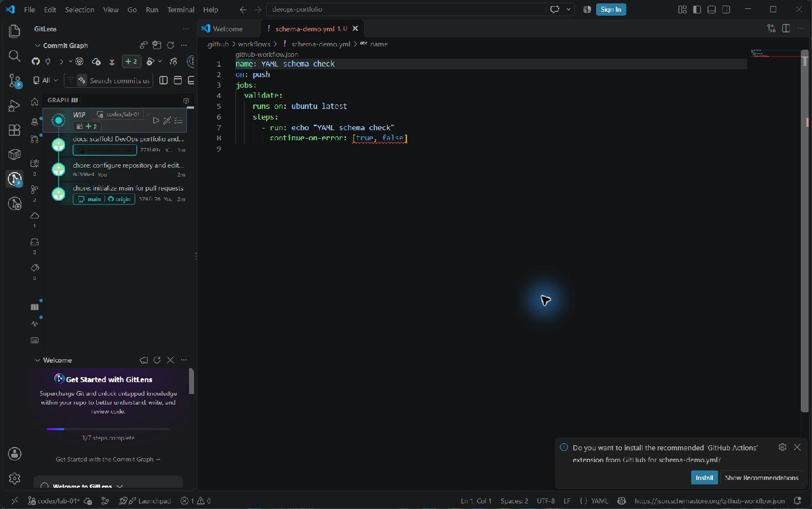

# Лабораторна робота 1 — Середовище та професійний Git workflow

## 1. Git і редактор

Перевірка на Windows, Git 2.56.1.windows.1. Вивід `git config --list --global`:

```text
core.editor="D:\Microsoft VS Code\bin\code" --wait
core.autocrlf=true
user.name=IgroIhroc
user.email=199837695+IgroIhroc@users.noreply.github.com
init.defaultbranch=main
pull.rebase=true
```

`user.name` задає підпис автора, а надана GitHub адреса `noreply` прив’язує коміти до профілю й зберігає приватність основної пошти. `init.defaultbranch=main` задає назву початкової гілки для нових репозиторіїв. `core.editor` відкриває VS Code і чекає, поки закриється файл повідомлення коміту.

На Windows `core.autocrlf=true` зазвичай перетворює CRLF на LF під час індексації та повертає CRLF у робочій копії. На Unix підходить `input`: воно нормалізує випадковий CRLF під час індексації, залишаючи LF у робочій копії. У змішаній команді без узгодженої політики редактори можуть зберігати різні кінці рядків. Тоді diff може показати зміни в кожному рядку, а Unix-скрипти з CRLF можуть не запускатися. У цьому репозиторії [.gitattributes](../.gitattributes) задає LF для текстових файлів на всіх ОС і має пріоритет над глобальним налаштуванням.

Коли локальна й віддалена гілки розійшлися, `pull.rebase=true` переносить локальні коміти поверх віддалених і змінює їхні ідентифікатори. Стратегія merge за тих самих умов створює коміт злиття із двома батьками. Rebase зручний для власних неопублікованих комітів. Історію спільної гілки переписувати після публікації ризиковано, бо колеги вже могли побудувати свої зміни на її комітах.

У VS Code встановлено GitLens для історії й авторства, Docker із Container Tools для Dockerfile і Compose, YAML від Red Hat для перевірки за схемою та EditorConfig. Для Markdown використовується вбудований попередній перегляд (`Ctrl+Shift+V`). [.editorconfig](../.editorconfig) задає відступи, LF і фінальний перенос. [Налаштування VS Code](../.vscode/settings.json) вмикають форматування під час збереження та прив’язують схеми GitHub Actions і Compose.

На скріншоті схема GitHub Actions підсвічує масив у `continue-on-error`: тут очікується булеве значення або вираз. Рядок стану також показує відступ у два пробіли та LF.



## 2. Середовища виконання

```text
> fnm --version
fnm 1.39.0
> fnm use 24
Using Node v24.22.3
> node --version
v24.22.3
> fnm use 26
Using Node v26.13.1
> node --version
v26.13.1
> python --version
Python 3.15.2
> docker --version
Docker version 29.9.3, build 5457199
> docker compose version
Docker Compose version v5.7.0
> docker info --format '{{.ServerVersion}}'
29.9.3
```

Node.js встановлено через fnm, гілку 26 встановлено командою `fnm install --lts`. Для нової сесії PowerShell середовище ініціалізується командою `fnm env --shell powershell | Out-String | Invoke-Expression`. Python 3.15.2 керується Python Install Manager, що підтверджує `py list`.

Для перевірки саме Compose v2 офіційний плагін v2.40.3 встановлено в окремий профіль Docker CLI. Вбудований у Docker Compose v5.7.0 доступний у стандартному профілі. [Реліз Compose v2.40.3](https://github.com/docker/compose/releases/tag/v2.40.3) · [Історія версій Compose](https://docs.docker.com/compose/intro/history/)

```text
> $env:DOCKER_CONFIG = Join-Path $env:LOCALAPPDATA 'DevOpsPortfolio\docker-v2'
> docker compose version
Docker Compose version v2.40.3
```

Менеджер версій дає змогу тримати кілька версій інтерпретатора паралельно. Наприклад, старий проєкт може потребувати Node.js 24, а новий — Node.js 26. Зафіксована версія дає команді та CI однакове середовище і дозволяє оновлювати проєкти незалежно.

## 3. GitHub і доступ

Профіль GitHub — [IgroIhroc](https://github.com/IgroIhroc). Ім’я та короткий опис профілю ще потрібно заповнити. Двофакторна автентифікація (2FA) вимкнена.

Власник облікового запису виконав `ssh -T git@github.com` і отримав підтвердження автентифікації:

```text
Hi IgroIhroc! You've successfully authenticated, but GitHub does not provide shell access.
```

Для відтворення налаштування потрібно створити ключ через `ssh-keygen -t ed25519` із парольною фразою, додати файл `.pub` до GitHub, звірити відбиток сервера та виконати `ssh -T git@github.com`. [Відбитки ключів GitHub](https://docs.github.com/en/authentication/keeping-your-account-and-data-secure/githubs-ssh-key-fingerprints) · [Перевірка підключення](https://docs.github.com/en/authentication/connecting-to-github-with-ssh/testing-your-ssh-connection)

Приватний ключ дає змогу підписувати запити від імені власника скрізь, де довіряють його публічній частині. Парольна фраза захищає ключ на диску, але копія в історії Git дає стороннім час на офлайн-підбір.

1. Негайно видалити відповідний публічний ключ із GitHub та інших сервісів і серверів, де він авторизований.
2. Створити новий ключ із новою парольною фразою, оновити авторизацію та перевірити доступ.
3. Перевірити журнали аудиту й зміни за період витоку. Якщо видно сторонній доступ, повідомити команду й відкликати пов’язані облікові дані.
4. Видалити ключ із робочих файлів. За потреби узгодити очищення історії через `git-filter-repo` та скоординувати оновлення гілок, клонів і форків. Відкликання потрібне навіть після очищення, оскільки могли залишитися копії. [Порядок реагування GitHub](https://docs.github.com/en/code-security/tutorials/remediate-leaked-secrets/remediating-a-leaked-secret)

## 4. Портфоліо

[devops-portfolio](https://github.com/IgroIhroc/devops-portfolio) — публічний репозиторій. [.gitignore](../.gitignore) згенеровано сервісом gitignore.io з шаблонів Node, Python, Visual Studio Code і Windows. MIT обрано, щоб навчальні приклади можна було повторно використовувати й змінювати за умови збереження тексту ліцензії та повідомлення про авторство.

## 5. Правила репозиторію

Активний [ruleset Protect main](https://github.com/IgroIhroc/devops-portfolio/rules/27496056) вимагає pull request, забороняє force-push і видалення `main`, а також вимагає лінійної історії. Дозволено rebase і squash. Для цієї роботи обрано rebase merge, щоб у `main` залишилися окремі змістовні коміти. Соло-режим має нуль обов’язкових схвалень та admin bypass лише в межах PR. Перевірки статусу додаються після першого запуску завдань CI.

У команді варто вимагати щонайменше одне незалежне схвалення, скидати застарілі схвалення після суттєвих змін, забрати адміністративний обхід і згодом вимагати результатів CI. У команді інший учасник може перевірити PR, тому адміністратор теж проходить звичайну процедуру. У соло-репозиторії обов’язкова незалежна рецензія разом із вимкненим обходом заблокує злиття, оскільки автор не може схвалити власний PR.

На GitHub заведено [задачі курсу](https://github.com/IgroIhroc/devops-portfolio/issues). Дошка Projects, її статуси та вбудовані автоматизації очікують налаштування.
